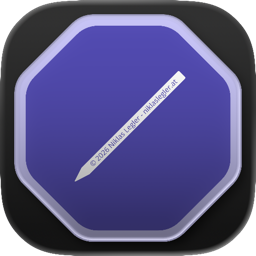
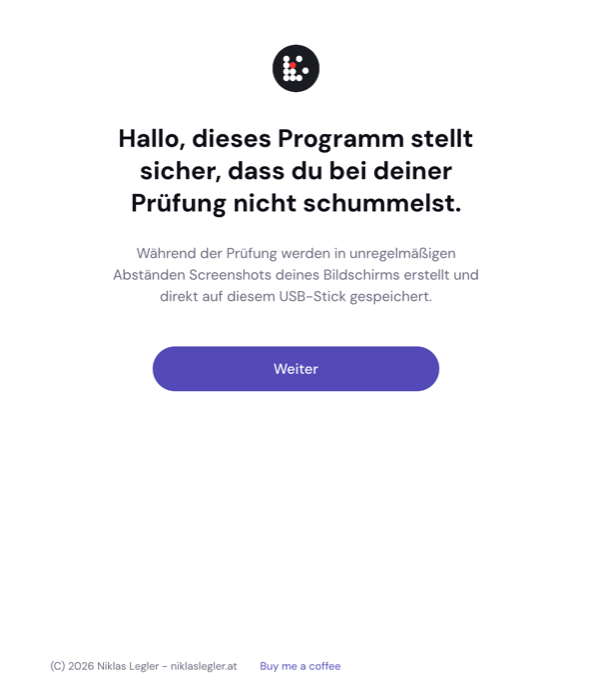
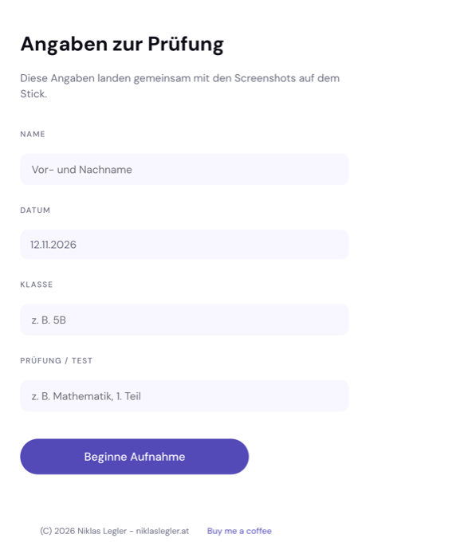
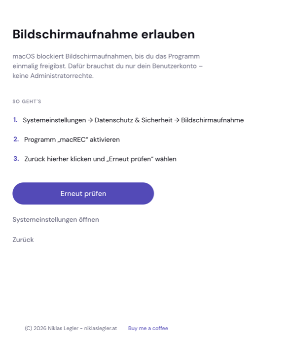
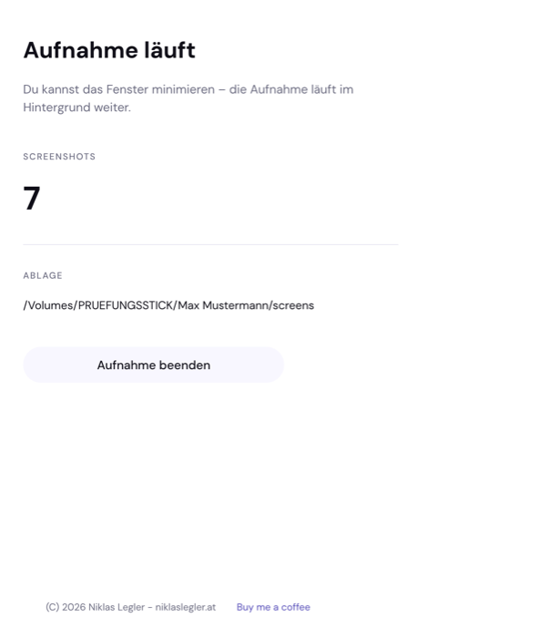

<div align="center">

<a href="https://buymeacoffee.com/niklaslegler">
  
</a>

<br><br>



# macREC

**Prüfungsaufsicht – die Aufnahmesoftware für den USB-Stick**

Project Page: https://links.legl3r.com/macrec-pruefungssoftware



[English below](#english)

</div>

> **Status: Work in Progress**
>
> macREC ist in Entwicklung und **noch nicht für den Einsatz in Prüfungen
> freigegeben**. Die Oberfläche, der Aufnahmeablauf und die Dateiablage können
> sich jederzeit ändern. Bitte vor einem echten Prüfungseinsatz testen und
> Rückmeldungen an [niklaslegler.at/contact](https://niklaslegler.at/contact) senden.

---

## Inhalt

- [Was macht macREC?](#was-macht-macrec)
- [Screenshots](#screenshots)
- [Datenschutz](#datenschutz)
- [Aufbau auf dem Stick](#aufbau-auf-dem-stick)
- [Bedienung](#bedienung)
- [USB-Abbild (.img)](#usb-abbild-img)
- [Bauen](#bauen)
- [Aufbau des Quellcodes](#aufbau-des-quellcodes)
- [Mitwirken](#mitwirken)
- [Danke](#danke)
- [English](#english)

## Was macht macREC?

Ein Programm, das vom USB-Stick gestartet wird, den Prüfling durch einen kurzen
Wizard führt und anschließend in **unregelmäßigen Abständen (35–60 Sekunden)**
Screenshots des gesamten Bildschirms erstellt.

Die Aufnahmen landen **direkt auf demselben Stick** – ohne Installation, ohne
Administratorrechte, ohne Netzwerk. Es wird nichts auf den Rechner der
Prüfungsteilnehmenden geschrieben und nichts übertragen.

| | |
|---|---|
| **Plattformen** | macOS (Apple Silicon & Intel) und Windows (x64) |
| **Start** | Doppelklick auf den Stick, ohne Installation |
| **Speicherort** | ausschließlich der USB-Stick |
| **Netzwerk** | keinerlei Zugriff |

## Screenshots

<div align="center">

<table>
<tr>
<td width="50%"></td>
<td width="50%"></td>
</tr>
<tr>
<td align="center"><b>Startbildschirm</b></td>
<td align="center"><b>Angaben zur Prüfung</b></td>
</tr>
<tr>
<td></td>
<td></td>
</tr>
<tr>
<td align="center"><b>Freigabe für die Bildschirmaufnahme</b></td>
<td align="center"><b>Aufnahme läuft</b></td>
</tr>
</table>

</div>

## Datenschutz

Es werden **ausschließlich Bilder des Bildschirms** erstellt und auf demselben
USB-Stick gespeichert. Es findet **keine Übertragung**, keine Speicherung auf
dem Rechner und **keine Netzwerkkommunikation** statt.

In `info.json` stehen die eingegebenen Angaben und der Zeitraum der Prüfung.

## Aufbau auf dem Stick

```
<Stick>/
├── macREC - Aufnahmesoftware.app/   macOS
├── macREC.exe                        Windows
└── README.txt
```

Nach dem Start entsteht automatisch:

```
<Stick>/<Name>/
├── info.json                     Name, Klasse, Prüfung, Zeitraum, Anzahl
├── log.jsonl                     Protokoll je Aufnahme
└── screens/
    ├── image_0001.jpg
    ├── image_0002.jpg
    └── …
```

## Bedienung

1. **Wizard** – Begrüßung und Hinweis, dass Screenshots erstellt werden.
2. **Freigabe** (nur macOS) – Schritt-für-Schritt-Anleitung.
3. **Angaben** – Name, Datum (automatisch), Klasse, Prüfung/Test.
4. **Aufnahme** – läuft im Hintergrund. Das Fenster kann minimiert werden; die
   Aufnahme läuft weiter. Beenden nur über „Aufnahme beenden“.

Während der Aufnahme wird **kein Countdown** angezeigt – die Abstände sind
absichtlich unvorhersehbar (35–60 Sekunden, bei jeder Aufnahme neu gewürfelt).

Jedes Bild trägt mittig unten den Hinweis
`(C) 2026 Niklas Legler - niklaslegler.at`.

## USB-Abbild (.img)

Ein fertiges Abbild, das auf **jeden** Stick geschrieben werden kann – unabhängig
von der Größe des Sticks. Das Abbild ist **nicht bootfähig**: es enthält nur
Dateien. Nach dem Einstecken erscheinen die Dateien sofort im Datei-Manager.

```bash
# Abbild bauen (64 MB, erzeugt zusätzlich die FAT32-Variante)
./tools/build-img.sh 64

# Auf den Stick schreiben (jedes Brennwerkzeug funktioniert ebenso)
sudo dd if=dist/macREC-usb.img of=/dev/rdisk4 bs=4m
```

| Datei | Dateisystem | Für wen |
|---|---|---|
| `dist/macREC-usb.img` | exFAT | Standard – Windows und macOS |
| `dist/macREC-usb-fat32.img` | FAT32 | ältere Windows-Systeme |

Das Abbild enthält die Programme, die `README.txt` und die Skripte zur
Größenanpassung. Nach dem Brennen den Stick einmal auf die volle Kapazität
bringen – per Doppelklick auf `GROESSE ANPASSEN.command` (macOS) bzw.
`GROESSE ANPASSEN.cmd` (Windows). Die Brennskripte erledigen beides in einem
Schritt:

```bash
# macOS: schreiben und Größe anpassen
sudo ./tools/burn-mac.sh /dev/disk4

# Windows: schreiben und Größe anpassen
powershell -ExecutionPolicy Bypass -File tools\burn-windows.ps1 -Device 2
```

> **Hinweis:** exFAT und FAT32 lassen sich unter macOS und Windows nicht
> nachträglich vergrößern. Deshalb formatiert das Skript den Stick neu (eine
> Partition über die volle Kapazität) und legt die Dateien anschließend wieder an.

## Bauen

```bash
# macOS
cargo build --release
go run ./crates/packager app \
    --bin target/release/screenrecv \
    --icon crates/screenrecv/resources/app-icon.png \
    --out "dist/macREC - Aufnahmesoftware.app"

# Windows (Cross-Compile via cargo-xwin, Icon via llvm-rc)
cargo install cargo-xwin
PATH="/opt/homebrew/opt/llvm/bin:$PATH" \
    cargo xwin build --release --target x86_64-pc-windows-msvc
cp target/x86_64-pc-windows-msvc/release/screenrecv.exe dist/macREC.exe

# USB-Stick vorbereiten
go run ./crates/packager usb --root /Volumes/USB \
    --mac "dist/macREC - Aufnahmesoftware.app" --win dist/macREC.exe
```

### USB-Abbild bauen

```bash
./tools/build-img.sh 64           # 64 MB, erzeugt exFAT- und FAT32-Variante
```

## Aufbau des Quellcodes

| Pfad | Inhalt |
|---|---|
| `crates/screenrecv/src/main.rs` | Wizard, Formular, Aufnahme-Ansicht |
| `crates/screenrecv/src/theme.rs` | Design-System (Farben, Typografie, Bedienelemente) |
| `crates/screenrecv/src/capture.rs` | Bildschirmaufnahme und Aufnahme-Thread |
| `crates/screenrecv/src/watermark.rs` | Copyright-Hinweis in jedem Bild |
| `crates/screenrecv/src/storage.rs` | Ablage auf dem Stick, Dateinamen |
| `crates/screenrecv/src/manifest.rs` | `info.json` und `log.jsonl` |
| `crates/screenrecv/src/perm.rs` | macOS-Berechtigung (Screen Recording) |
| `crates/packager/main.go` | `.app`-Bundle, Icons, USB-Aufbau |
| `tools/build-img.sh` | USB-Abbild erzeugen (MBR + exFAT/FAT32) |
| `tools/burn-mac.sh` | Abbild schreiben und Größe anpassen (macOS) |
| `tools/burn-windows.ps1` | Abbild schreiben und Größe anpassen (Windows) |
| `tools/groesse-anpassen.sh` | Stick auf volle Kapazität erweitern (macOS) |
| `tools/groesse-anpassen.ps1` | Stick auf volle Kapazität erweitern (Windows) |
| `icon/Icon-1024x1024.png` | App-Icon |

Schriften: DM Sans (SIL Open Font License 1.1). Logo & Icon: Niklas Legler.

## Mitwirken

macREC ist ein **Work in Progress** – Rückmeldungen, Fehlerberichte und
Verbesserungsvorschläge sind sehr willkommen.

- [Issues auf GitHub](https://github.com/niklaslegler/macREC/issues)
- E-Mail an [niklaslegler.at/contact](https://niklaslegler.at/contact)

## Danke

<div align="center">

**macREC steht und fällt mit deiner Unterstützung.**

<a href="https://buymeacoffee.com/niklaslegler">
  
</a>

<br><br>

Wenn dir macREC hilft und du die Weiterentwicklung unterstützen möchtest,
freue ich mich über einen [Kaffee](https://buymeacoffee.com/niklaslegler) –
jede Spende geht direkt in die Entwicklung neuer Funktionen.

</div>

---

## English

**macREC** is a screen-recording app for exam supervision. It runs from a USB
stick, guides the examinee through a short wizard, and then takes screenshots of
the entire screen at irregular intervals (35–60 seconds). The images are written
straight to the same USB stick – no installation, no administrator rights, no
network access.

> **Status: work in progress.** macREC is still under development and **not
> yet approved for use in real exams**. The interface, the recording flow and
> the file layout may change at any time. Please test it before any real use and
> send feedback to [niklaslegler.at/contact](https://niklaslegler.at/contact).

| | |
|---|---|
| **Platforms** | macOS (Apple Silicon & Intel) and Windows (x64) |
| **Start** | double-click on the stick, nothing to install |
| **Storage** | the USB stick only |
| **Network** | none whatsoever |

### Building the USB image

```bash
./tools/build-img.sh 64           # 64 MB, creates an exFAT and a FAT32 variant
sudo dd if=dist/macREC-usb.img of=/dev/rdisk4 bs=4m
```

The image is **not bootable** – it only contains files, which show up in the
file manager as soon as the stick is plugged in. It contains the macOS app, the
Windows program, the README and the scripts that resize the stick. Run
`GROESSE ANPASSEN.command` (macOS) or `GROESSE ANPASSEN.cmd` (Windows) once on
the stick to let it use its full capacity. The burning scripts do both in one
go:

```bash
# macOS
sudo ./tools/burn-mac.sh /dev/disk4

# Windows
powershell -ExecutionPolicy Bypass -File tools\burn-windows.ps1 -Device 2
```

### Support

<a href="https://buymeacoffee.com/niklaslegler">
  
</a>

If you like macREC and want to support further development, a
[coffee](https://buymeacoffee.com/niklaslegler) is very welcome.

---

(C) 2026 Niklas Legler – [niklaslegler.at](https://niklaslegler.at)
